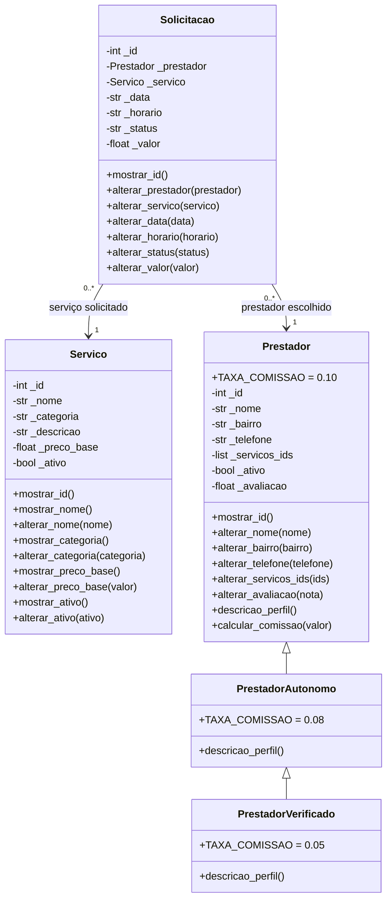

# Serviços do Bairro API

Backend didático para divulgar serviços oferecidos por profissionais da região e registrar solicitações de atendimento. O projeto é exclusivo do tema **Serviços do Bairro** e usa dados simulados em memória, sem banco de dados.

## Tecnologias

- Python 3.10 ou superior
- FastAPI
- Uvicorn

## Como executar no Windows (PowerShell)

Abra o terminal na pasta do projeto e execute:


```powershell
python -m venv venv
.\venv\Scripts\Activate.ps1
python -m pip install -r requirements.txt
python -m uvicorn main:app --reload
```

Se o PowerShell bloquear a ativação do ambiente virtual, é possível abrir o terminal CMD e executar `venv\Scripts\activate.bat` depois de criar o ambiente. Com a API em execução, abra **http://127.0.0.1:8000/docs** para testar as rotas interativamente.

Para executar as verificações automatizadas, em outro terminal na raiz do projeto:

```powershell
python verificar.py
```

## Estrutura exigida

```text
servicos-do-bairro/
├── main.py
├── requirements.txt
├── verificar.py
├── README.md
└── app/
    ├── __init__.py
    ├── data/
    │   ├── __init__.py
    │   ├── prestador_mock.py
    │   ├── servico_mock.py
    │   └── solicitacao_mock.py
    ├── models/
    │   ├── __init__.py
    │   ├── prestador.py
    │   ├── servico.py
    │   └── solicitacao.py
    ├── controllers/
    │   ├── __init__.py
    │   ├── prestador_controller.py
    │   ├── servico_controller.py
    │   └── solicitacao_controller.py
    └── routes/
        ├── __init__.py
        ├── prestador_routes.py
        ├── servico_routes.py
        └── solicitacao_routes.py
```

## Modelo de domínio

- **Servico:** representa um tipo de serviço local, com categoria, descrição, preço-base e situação.
- **Prestador:** representa a pessoa que oferece serviços no bairro.
- **PrestadorAutonomo:** especializa `Prestador` e usa uma comissão própria.
- **PrestadorVerificado:** especializa `PrestadorAutonomo`, acrescentando a descrição de perfil verificado e outra comissão.
- **Solicitacao:** registra o serviço solicitado, o prestador escolhido, data, horário, status e valor combinado.

### Diagrama UML



No diagrama, `-` representa atributo protegido e `+` representa membro público. A associação mostra que cada solicitação está ligada a exatamente um prestador e um serviço; um prestador ou serviço pode aparecer em várias solicitações.

## Herança e polimorfismo

A hierarquia é `Prestador → PrestadorAutonomo → PrestadorVerificado`. Cada perfil declara sua constante `TAXA_COMISSAO`: 10%, 8% e 5%. O cálculo de comissão é herdado e consulta a constante da classe concreta do objeto, sem `if` para descobrir seu tipo. Os métodos `descricao_perfil()` são sobrescritos e usam `super()` para estender a descrição do perfil anterior.

O dicionário `PERFIS`, em `app/models/prestador.py`, associa os textos presentes nos mocks às classes correspondentes.

## Regras de negócio

1. Nome, categoria e descrição do serviço são obrigatórios.
2. O preço-base de um serviço deve ser maior que zero.
3. O prestador precisa ter nome, bairro, telefone válido e ao menos um serviço ofertado.
4. A avaliação deve ficar entre 0 e 5.
5. Não se pode solicitar um serviço ou profissional inativo.
6. O prestador selecionado precisa oferecer o serviço solicitado.
7. A data e o horário precisam estar em formato válido; o status deve pertencer à lista permitida.
8. O valor da solicitação deve ser positivo.
9. O mesmo prestador não pode receber duas solicitações ativas para o mesmo dia e horário. Solicitações canceladas não bloqueiam o horário.

As regras de entidade são verificadas nas models com `raise ValueError`. O controller verifica conflito entre solicitações; as routes traduzem os resultados em códigos HTTP.

## Rotas da API

| Método | Rota | Descrição | Respostas principais |
|---|---|---|---|
| GET | `/api/servicos` | Lista todos os serviços | `200` |
| GET | `/api/servicos/categoria/{categoria}` | Filtra serviços por categoria | `200` |
| GET | `/api/servicos/{servico_id}` | Busca um serviço | `200`, `404` |
| GET | `/api/prestadores?bairro=Centro` | Lista profissionais; filtro de bairro opcional | `200` |
| POST | `/api/solicitacoes` | Registra uma solicitação | `201`, `404`, `409`, `422` |
| GET | `/api/prestadores/{prestador_id}/solicitacoes` | Histórico de solicitações do prestador | `200`, `404` |
| GET | `/api/relatorio/comissoes` | Estima as comissões por prestador | `200` |

### Exemplo de corpo para criar uma solicitação

```json
{
  "prestador_id": 1,
  "servico_id": 1,
  "data": "2026-11-03",
  "horario": "10:30",
  "status": "solicitada"
}
```

`valor` é opcional; quando omitido, é utilizado o preço-base do serviço. O serviço precisa estar na lista de serviços do prestador. Em caso de conflito de horário, a API retorna `409`; regras de negócio inválidas retornam `422`.

## Dados simulados

Os arquivos `app/data/*_mock.py` contêm apenas listas de dicionários, sem classes, imports ou regras. Há pelo menos cinco registros em cada conjunto de dados. Os objetos são construídos pelas funções `carregar_*()` das models. As listas ficam em memória durante a execução e voltam aos dados originais quando o processo é reiniciado.

## Divisão do trabalho

Preencher com os integrantes reais e as contribuições efetivamente realizadas antes da entrega:

| Integrante | Contribuição |
|---|---|
| Integrante 1 - preencher | Models e regras de negócio |
| Integrante 2 - preencher | Controllers e rotas |
| Integrante 3 - preencher | Verificações, README e revisão geral |
| Integrante 4 - preencher (se houver) | Testes manuais, diagrama e revisão |

## Saída de `python verificar.py`

A saída real das verificações deve permanecer colada abaixo. Execute `python verificar.py` antes da entrega e atualize este bloco caso o código seja alterado.

```text
OK - Existem pelo menos 5 serviços mockados
OK - Existem pelo menos 5 prestadores mockados
OK - Existem pelo menos 5 solicitações mockadas
OK - Todos os preços dos serviços são positivos
OK - Todos os prestadores possuem ao menos um serviço
OK - A hierarquia de herança tem dois níveis
OK - As subclasses definem taxas de comissão diferentes
OK - O método sobrescrito estende a descrição usando super()
OK - O cálculo polimórfico produz comissões diferentes
OK - A model recusa preço de serviço igual a zero
OK - A model recusa avaliação fora da faixa de 0 a 5
OK - A model recusa lista vazia de serviços do prestador
OK - A model recusa data em formato inválido
OK - A model recusa horário inválido
OK - A model recusa status que não pertence à lista permitida
OK - O filtro por categoria retorna apenas serviços da categoria pedida
OK - A busca de serviço inexistente retorna None
OK - O controller cria uma solicitação válida
OK - O controller recusa duas solicitações no mesmo horário do prestador
OK - O relatório de comissões inclui todos os prestadores

Resultado: 20/20 verificações aprovadas.
```
